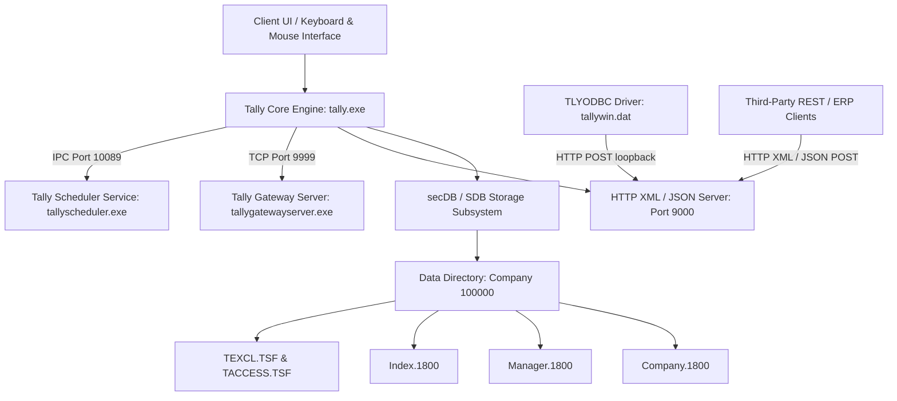
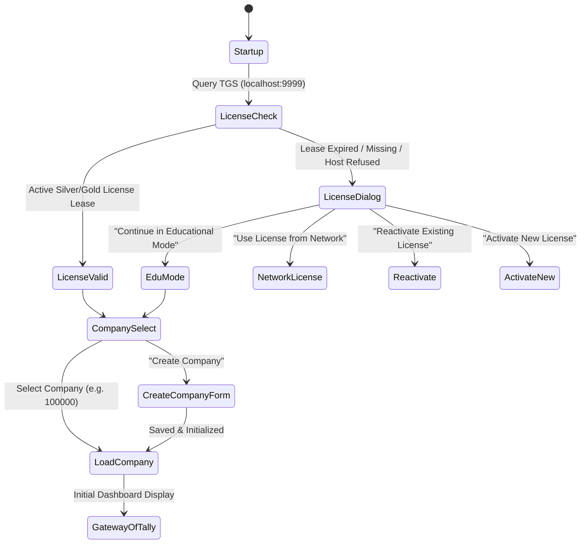
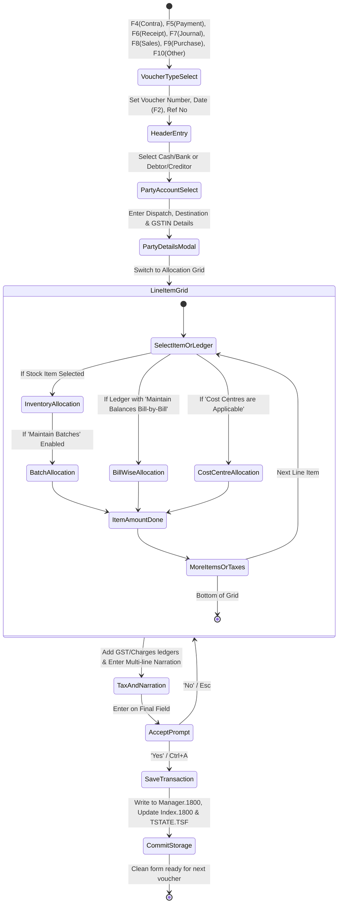

# Clean-Room Implementation Specification: TallyPrime Clone (CLONE_SPEC)

**Target Software**: TallyPrime (Release 1.1 / Build 1.1.7.2 x64)  
**Binary Sources Analyzed**:
* `C:\Program Files\TallyPrime\tally.exe` (SHA-256: `856e5236a7664c0d8d580585e1c31b443720badd7a0078512d41f6c380b7ed73`)
* `C:\Program Files\TallyPrime\tallywin.dat` (`TLYODBC.dll`, SHA-256: `91d15a16841e7d030265590b9cb551fdabcdcb7e653321ac327b96195700dbf9`)
* `C:\Program Files\TallyPrime\tallygatewayserver.exe` (SHA-256: `4259008` bytes)
* `C:\Program Files\TallyPrime\tallyscheduler.exe` (SHA-256: `5595328` bytes)
* `D:\Tally\setup.exe` (SHA-256: `55e2668a5f625bd216c5139cdd3aeb5095cf5793f3326bbb1c02e3d69be96627`)
* `C:\Program Files\TallyPrime\tally.ini` & `tallygateway.ini`
* `C:\Users\Public\TallyPrime\data\100000\*`
* `C:\Program Files\TallyPrime\logs\tallyscheduler.log`

---

## 1. System Architecture Overview

The software operates as a hybrid accounting engine, database management system, and application server:



---

## 2. User-Visible Features & Screen Hierarchy

### 2.1 Navigation Model & Keyboard Philosophy
* **First-Class Keyboard Navigation**: Every screen, menu, field, and button is operable via dedicated hotkeys or single-letter menu shortcuts (highlighted characters).
* **Escape Stack**: Pressing `Esc` unconditionally pops the current view or brings up the confirmation prompt (`Quit? Yes or No`).
* **Universal Go To (`Alt+G`) / Switch To (`Ctrl+G`)**: A non-modal overlay allowing instantaneous switching to any report, master, or voucher without losing the active entry state.
* **Date / Period Switchers**:
  * `F2`: Changes the current working transaction date.
  * `Alt+F2`: Changes the active reporting period (`From: <Date>` to `To: <Date>`).

### 2.2 Screen Hierarchy Tree

```
Gateway of Tally (Root State)
├── Top Menu Bar
│   ├── K: Company (Alt+K) -> [Select, Shut, Create, Alter, Change, Configure]
│   ├── Y: Data (Alt+Y) -> [Backup, Restore, Split, Repair/Rewrite]
│   ├── Z: Exchange (Alt+Z) -> [Data Synchronisation, Send/Receive, WhatsApp]
│   ├── G: Go To (Alt+G) -> [Universal Search Navigation Bar]
│   ├── O: Import (Alt+O) -> [Masters, Transactions, Bank Statements]
│   ├── E: Export (Alt+E) -> [Export Current View: PDF, Excel, XML, CSV, HTML]
│   ├── M: E-mail (Alt+M) -> [SMTP / OAuth Email Dispatch]
│   ├── P: Print (Alt+P) -> [Print Configuration & Output]
│   └── F1: Help -> [About, Upgrade, Troubleshooting, TallyHelp]
│
├── Masters
│   ├── Create
│   │   ├── Accounting Masters: Group, Ledger, Currency, Voucher Type
│   │   ├── Inventory Masters: Stock Group, Stock Category, Stock Item, Unit, Godown
│   │   └── Statutory Masters: GST Registrations, Tax Classifications
│   ├── Alter (Same categories as Create, for editing)
│   └── Chart of Accounts (Tree view with drilldown into Ledgers & Items)
│
├── Transactions
│   ├── Vouchers (Voucher Entry State Machine)
│   └── Day Book (Daily Chronological Register)
│
├── Utilities
│   └── Banking
│       ├── Bank Reconciliation
│       ├── Cheque Printing
│       ├── Cheque Register
│       ├── Post-Dated Summary
│       └── Deposit Slip
│
└── Reports
    ├── Balance Sheet (Horizontal / Vertical Asset-Liability Ledger)
    ├── Profit & Loss A/c (Trading, Gross Profit, Indirect Expenses, Net Profit)
    ├── Stock Summary (Inventory Valuation, Inwards, Outwards, Closing Balance)
    ├── Ratio Analysis (Current Ratio, Quick Ratio, Debt-Equity, Working Capital)
    └── Display More Reports
        ├── Trial Balance
        ├── Cash Flow & Funds Flow
        ├── Account Books (Cash/Bank Book, Ledger, Group Summary, Registers)
        ├── Statements of Accounts (Outstandings, Cost Centres, Statistics)
        ├── Statements of Inventory (Godown Summary, Movement Analysis)
        ├── Statutory Reports (GSTR-1, GSTR-3B, GSTR-2B Reconciliation)
        └── Exception Reports (Negative Ledgers, Negative Stock, Overdue Bills)
```

---

## 3. Screen State Machines & Interactive Flows

### 3.1 Startup & Licensing State Machine



* **Evidence**:
  * `tallyscheduler.log:115` (`TaskLicenseHelper::InitializeLicForSch: Contacting GW IP (localhost) and port (9999)`).
  * Error code `-10061` (`Connector error: No connection could be made because the target machine actively refused it`).
  * `tally.ini` keys: `Tally Gateway Server=localhost:9999`, `Tally Gold License Server=`.

---

### 3.2 Voucher Entry State Machine



#### Voucher Inputs & Fields
| Field Name | Type | Constraints & Validation | Edge Cases |
| :--- | :--- | :--- | :--- |
| **Voucher Type** | Enum | Must exist in `VoucherType` master | Inactive voucher types rejected |
| **Voucher Date** | Date (`YYYYMMDD`) | Must fall within Company Financial Year | Educational Mode restricts dates to 1st, 2nd, and 31st of any month |
| **Voucher Number** | String (Max 50) | Unique per voucher type if configured Automatic (Manual Override) | Prefixes/Suffixes appended per numbering rules |
| **Party Account** | Reference | Foreign key to `Ledger` master | Credit limit violation prompts warning |
| **Bill-wise Ref** | Enum + String | `New Ref`, `Agst Ref`, `Advance`, `On Account` | `Agst Ref` validates pending bill balance |
| **Inventory Alloc** | Complex | Item Ref, Godown Ref, Batch, Qty, Rate, Unit | Negative stock prompts configurable warning |
| **Narration** | String | Multi-line text (Max 250 chars per line, up to 10 lines) | Control characters stripped |

---

## 4. File Formats & Persistence Layout

### 4.1 Directory Layout
```
<Company Data Directory>/ (Default: C:\Users\Public\TallyPrime\data\100000\)
├── Company.1800         # Master company record & financial calendar
├── Manager.1800         # Primary object storage (Masters, Ledgers, Vouchers)
├── Index.1800           # Primary B-Tree search index table
├── TranMgr.1800         # Transaction commit state & active sequence counter
├── VchStatus.1800       # Voucher lifecycle & cancellation status bits
├── StatStatus.1800      # Statutory engine compliance state
├── TACCESS.TSF          # Multi-user read/write concurrency tracking
├── TEXCL.TSF            # Exclusive lock token (0 bytes; locked by OS handle)
├── TSTATE.TSF           # Write-ahead transaction state log
├── TUPDATE.TSF          # Sync status log for remote / gateway updates
├── AddlCmp.1800         # Additional company configuration properties
├── Aggr.1800            # Aggregated balance cache (trial balance cache)
├── CmpNotification.1800 # Company notification state
├── CmpSave.1800         # Saved user-specific view layouts
└── CmpSchMetaData.1800  # Company scheduler tasks metadata
```

### 4.2 SDB File Format Specification (`.TSF`, `.CIF`, `.DIF`, `.TUF`, `tallyapp.dat`)
All core metadata, configuration, and capsule files use the **SDB (Secure DataBase)** container format.

* **Magic Bytes (0x00 - 0x07)**:
  ```
  HEX:   89 53 44 42 0D 0A 1A 0A
  ASCII: \x89 S D B \r \n \x1a \n
  ```
  *(Byte sequence intentionally mimics PNG to trigger immediate I/O failure upon corrupted ASCII/CRLF conversion).*
* **Header Structure (0x08 - 0x37, 56 Bytes Total)**:
  * Offset `0x08 - 0x0B` (4 Bytes): Checksum / Header Hash
  * Offset `0x0C - 0x0F` (4 Bytes): Format Major Version (`0x00000002`)
  * Offset `0x10 - 0x13` (4 Bytes): Format Minor Version (`0x00000002`)
  * Offset `0x14 - 0x17` (4 Bytes): Header Length (`0x00000038` = 56 bytes)
  * Offset `0x18 - 0x1B` (4 Bytes): Table / Entry Record Count
  * Offset `0x1C - 0x37`: Table Allocation Bitmap / Segment Table
* **Payload**:
  * Deflate/Zlib compressed streams containing serialized TDL object definitions or state records.

### 4.3 Data Store Format (`.1800`)
* **`Index.1800`**:
  * Offset `0x00 - 0x07`: Header signature (`cde3204e01000000`)
  * Offset `0x08 - 0x0C`: Index Version / Flags
  * Offset `0x0D - 0x17`: Literal Magic String `"Tally Index"`
  * Payload: Fixed-size 64-byte index leaf slots storing `[Object GUID (16 bytes) | Offset in Manager.1800 (8 bytes) | Record Length (4 bytes) | Object Type Flag (4 bytes) | Checksum (4 bytes) | Reserved (28 bytes)]`.
* **`Manager.1800`**:
  * Sequential, append-only object store.
  * Deleted / modified records are appended with new sequence numbers; `Index.1800` is repointed to the newest offset.
  * Compacted during `Rewrite` (`Alt+Y -> Repair`).
* **`TEXCL.TSF`**:
  * File size: Exactly `0` bytes.
  * Exclusivity enforcement: Opened with `CreateFileW(..., GENERIC_READ | GENERIC_WRITE, 0, NULL, OPEN_EXISTING, ...)` (ShareMode = 0). When a company is opened in exclusive write mode (e.g. during split, repair, or single-user license), this OS handle lock prevents any other process or network station from accessing the directory.

---

## 5. Network Protocols & Integration Endpoints

### 5.1 HTTP XML / REST API (Port 9000)
Tally runs an internal HTTP server on the port defined by `ServerPort` in `tally.ini` (default `9000`).

#### Protocol Wire Characteristics
* **HTTP Method**: `POST / HTTP/1.0` or `POST / HTTP/1.1`
* **Port**: `9000` (Evidence: `tally.ini: ServerPort=9000`)
* **Mandatory Custom Headers**:
  ```http
  POST / HTTP/1.0
  Content-Length: <ByteLength>
  Compressed: No
  Unicode: YES
  Content-Type: text/xml;charset=utf-8
  ```
  *(Evidence: `tallywin.dat:0x1c2880` - `0x1c28b7`).*

#### Request 1: Export Report / Master Data (XML)
* **Request Envelope**:
  ```xml
  <ENVELOPE>
    <HEADER>
      <TALLYREQUEST>Export Data</TALLYREQUEST>
    </HEADER>
    <BODY>
      <EXPORTDATA>
        <REQUESTDESC>
          <REPORTNAME>Trial Balance</REPORTNAME>
          <STATICVARIABLES>
            <SVEXPORTFORMAT>$$SysName:XML</SVEXPORTFORMAT>
            <SVCURRENTCOMPANY>100000</SVCURRENTCOMPANY>
            <SVFROMDATE>20260401</SVFROMDATE>
            <SVTODATE>20270331</SVTODATE>
          </STATICVARIABLES>
        </REQUESTDESC>
      </EXPORTDATA>
    </BODY>
  </ENVELOPE>
  ```

#### Request 2: Execute Direct SQL via ODBC Wrapper
* **Request Envelope**:
  ```xml
  <ENVELOPE>
    <HEADER>
      <TALLYREQUEST>Export Data</TALLYREQUEST>
    </HEADER>
    <BODY>
      <EXPORTDATA>
        <REQUESTDESC>
          <REPORTNAME>ODBC Report</REPORTNAME>
          <STATICVARIABLES>
            <SVEXPORTFORMAT>$$SysName:XML</SVEXPORTFORMAT>
          </STATICVARIABLES>
        </REQUESTDESC>
        <REQUESTDATA>
          <SQLREQUEST>
            <Type>Method</Type>
            <SQLQuery>SELECT $Name, $Parent, $ClosingBalance FROM Ledger</SQLQuery>
          </SQLREQUEST>
        </REQUESTDATA>
      </EXPORTDATA>
    </BODY>
  </ENVELOPE>
  ```
  *(Evidence: `tallywin.dat:0x1c1b20`, `0x1c2788 - 0x1c2830`).*

#### Request 3: Import / Post Transaction
* **Request Envelope**:
  ```xml
  <ENVELOPE>
    <HEADER>
      <TALLYREQUEST>Import Data</TALLYREQUEST>
    </HEADER>
    <BODY>
      <IMPORTDATA>
        <REQUESTDESC>
          <REPORTNAME>All Masters</REPORTNAME>
          <STATICVARIABLES>
            <SVCURRENTCOMPANY>100000</SVCURRENTCOMPANY>
          </STATICVARIABLES>
        </REQUESTDESC>
        <REQUESTDATA>
          <TALLYMESSAGE xmlns:UDF="TallyUDF">
            <VOUCHER VCHTYPE="Payment" ACTION="Create" OBJVIEW="Accounting Voucher View">
              <DATE>20261022</DATE>
              <VOUCHERTYPENAME>Payment</VOUCHERTYPENAME>
              <VOUCHERNUMBER>1</VOUCHERNUMBER>
              <PARTYLEDGERNAME>Cash</PARTYLEDGERNAME>
              <NARRATION>Clean-room test transaction</NARRATION>
              <ALLLEDGERENTRIES.LIST>
                <LEDGERNAME>Stationery Expenses</LEDGERNAME>
                <ISDEEMEDPOSITIVE>Yes</ISDEEMEDPOSITIVE>
                <AMOUNT>-500.00</AMOUNT>
              </ALLLEDGERENTRIES.LIST>
              <ALLLEDGERENTRIES.LIST>
                <LEDGERNAME>Cash</LEDGERNAME>
                <ISDEEMEDPOSITIVE>No</ISDEEMEDPOSITIVE>
                <AMOUNT>500.00</AMOUNT>
              </ALLLEDGERENTRIES.LIST>
            </VOUCHER>
          </TALLYMESSAGE>
        </REQUESTDATA>
      </IMPORTDATA>
    </BODY>
  </ENVELOPE>
  ```

#### Response Envelope (Success)
```xml
<ENVELOPE>
  <HEADER>
    <VERSION>1</VERSION>
    <STATUS>1</STATUS>
  </HEADER>
  <BODY>
    <DATA>
      <IMPORTRESULT>
        <CREATED>1</CREATED>
        <ALTERED>0</ALTERED>
        <DELETED>0</DELETED>
        <ERRORS>0</ERRORS>
      </IMPORTRESULT>
    </DATA>
  </BODY>
</ENVELOPE>
```

#### Response Envelope (Failure / Fault)
```xml
<ENVELOPE>
  <HEADER>
    <VERSION>1</VERSION>
    <STATUS>0</STATUS>
  </HEADER>
  <BODY>
    <FAULT>
      <FAULTCODE>Server</FAULTCODE>
      <FAULTSTRING>Ledger 'Stationery Expenses' does not exist!</FAULTSTRING>
    </FAULT>
  </BODY>
</ENVELOPE>
```

---

### 5.2 ODBC Interface Driver (`TLYODBC.dll` / `tallywin.dat`)
* **Architecture**: Acts as a client-side SQL-to-HTTP translator.
* **Driver DSN Parameters**:
  * `DRIVER`: `Tally ODBC Driver64`
  * `SERVER`: Default `localhost`
  * `PORT`: Default `9000`
  * `COMPANY`: Active company name or GUID
* **ODBC 3.0 API Implementation**:
  * Implements `SQLConnectW`, `SQLDriverConnectW`, `SQLExecDirectW`, `SQLPrepareW`, `SQLFetch`, `SQLGetData`, `SQLColumnsW`, `SQLTablesW`.
  * Translates incoming ANSI/Unicode SQL into an `<ENVELOPE>` containing `<SQLREQUEST>` sent over loopback TCP socket to port 9000.
  * Translates received `<ROWDESC>` and `<RESULTDATA>` into standard ODBC C-types (`SQL_C_CHAR`, `SQL_C_DOUBLE`, `SQL_C_TYPE_DATE`).

---

### 5.3 Tally Gateway Server (TGS) Protocol (Port 9999)
* **Binary Provider**: `tallygatewayserver.exe`
* **Configuration**: `tallygateway.ini` (`LicServerPort=9999`)
* **Port**: `9999`
* **Role**:
  * Centralized license lease management.
  * Silver License: Exactly 1 concurrent active client IP connection.
  * Gold License: Unlimited concurrent client connections across the local network subnet.
  * Client heartbeat every 60 seconds (`LicTimeout=` in `tallyini`). Failure to respond after 3 consecutive intervals drops license to Educational Mode.

---

### 5.4 Background Scheduler Service (Port 10089)
* **Binary Provider**: `tallyscheduler.exe`
* **Port**: `10089` (Evidence: `tallyscheduler.log:1209`: `Tally Scheduler 1.0 installed and running on port 10089`)
* **Functions**:
  * Background automated data backup creation.
  * Scheduled bank statement auto-fetching and synchronization.
  * Auto-upload of e-Invoices and e-Way bills to GST portal.

---

## 6. Settings & Configuration Specifications (`tally.ini`)

| Parameter | Type | Default Value | Description |
| :--- | :--- | :--- | :--- |
| `Tally Gateway Server` | `host:port` | `localhost:9999` | IP and port of the TGS license server |
| `User TDL` | `Boolean` | `Yes` | Whether custom TDL extension scripts should be executed |
| `Default Companies` | `Boolean` | `Yes` | Preloads default company list on startup |
| `Load` | `Integer` | `100000` | Company ID to load automatically on startup |
| `Data` | `Path` | `C:\Users\Public\TallyPrime\data` | Base directory containing company data directories |
| `ShowDashboardOnCompanyLoad`| `Boolean` | `No` | Whether to display summary graphical dashboard upon opening |
| `ServerPort` | `Integer` | `9000` | Port for the HTTP XML/ODBC interface |
| `Enable ODBC Server` | `Boolean` | `Yes` | Enables loopback ODBC query listening |
| `IncrementalBackupBufferLimit`| `Integer`| `1024` | Size limit in MB for `IncrState.1800` before rolling over |
| `MigrationTallyPrimePort` | `Integer` | `9009` | Port used during automated database version upgrades |
| `MigrationToolPort` | `Integer` | `9509` | Port for `tallymigrationtool.exe` |
| `MigrationBatchSize` | `Integer` | `200` | Chunk batch size during record migration |
| `ComfortView` | `String` | `Bright` | Color contrast mode (`Bright` or `Classic`) |
| `Width` / `Height` | `Integer` | `1920` / `1020` | Default startup window geometry |

---

## 7. Error Handling, Diagnostics & Edge Cases

### 7.1 Diagnostic Logging Specifications
* **Error Log File**: `tallyerr.log` (generated in executable directory).
* **Crash Dump Mechanism**: Windows SEH unhandled exception filter calls `MiniDumpWriteDump` from `dbghelp.dll`, writing a `.dmp` file named `<ExecutableName><PID>.dmp`.
* **Standard Engine Error Dictionary**:
  *(Extracted verbatim from `tallywin.dat:0x1c34c8 - 0x1c3790`)*:
  * `Out of memory.` -> Raised when memory manager fails virtual allocation budget.
  * `Insufficient file handles.` -> Raised when OS file handle limit (< 512) is reached.
  * `File not found.` -> Raised on missing master or index leaf.
  * `Path not found.` -> Raised on invalid data path in `tally.ini`.
  * `Access denied.` -> Raised when file permissions block write to `Manager.1800`.
  * `Error Creating File.` -> Raised on I/O error during export/backup.
  * `Incorrect File Size.` -> Raised when file size does not match record slot allocation header.
  * `Error Reading Data.` -> CRC32 mismatch on record chunk.
  * `Error Writing Data.` -> Disk write returned short byte count.
  * `File Damaged.` -> SDB / `89 53 44 42` magic corrupted; triggers prompt to run Repair (`Rewrite`).
  * `No space on disk.` -> Raised when write fails due to `ERROR_DISK_FULL`.
  * `Incorrect version.` -> Database created in newer Tally schema version; requires migration.
  * `Error in TDL.` -> Syntax or symbol resolution error during TDL parsing.
  * `TallyLock not found.` -> Hardware dongle / soft-license lease invalid.
  * `Cannot understand.` -> Unrecognized command or token during import parse.

### 7.2 Concurrency & Edge Cases
1. **Multi-User Lock Contention**:
   * If station A is writing a voucher, station B attempting to write to the same company receives a non-blocking retry wait (up to 3000ms).
   * If station A crashes while holding a write token, `TSTATE.TSF` write-ahead log rolls back uncommitted records on the next opening.
2. **Crash in Educational Mode**:
   * License reverts to Educational Mode (`Edu Mode`); transactions cannot be saved with arbitrary dates (only 1st, 2nd, 31st).
3. **Bill-Wise Allocation Mismatch**:
   * Sum of bill allocations (`New Ref` + `Agst Ref` + `Advance`) must exactly match total voucher ledger amount. If unequal, cursor is blocked from leaving the allocation table.
4. **Negative Cash Balance Warning**:
   * If Cash ledger drops below 0.00, modal warning dialog is triggered; configurable in `F12: Configure -> Warn on Negative Cash Balance`.

---

## 8. Summary of Known vs. Unknown Facets

| Subsystem / Feature | Status | Provenance & Evidence Citation |
| :--- | :--- | :--- |
| **HTTP Server & Port** | CONFIRMED | `tally.ini` (`ServerPort=9000`), `tallywin.dat` (`0x1c2880`) |
| **HTTP Wire Headers** | CONFIRMED | `tallywin.dat` (`POST / HTTP/1.0`, `COMPRESSED: No`, `UNICODE: YES`) |
| **ODBC Architecture** | CONFIRMED | `tallywin.dat` (`TLYODBC.dll` exports & SQL-to-SOAP bridge) |
| **SDB Container Magic** | CONFIRMED | `tally.cif`, `tallycfg.tsf`, `tallyapp.dat` (`89 53 44 42 0D 0A 1A 0A`) |
| **Data Directory Layout** | CONFIRMED | `C:\Users\Public\TallyPrime\data\100000\*` file enumeration |
| **Index Magic String** | CONFIRMED | `Index.1800` (`Tally Index` at offset `0x0D`) |
| **Scheduler Port & Logs** | CONFIRMED | `tallyscheduler.log` (Port `10089`, C++ sources cited) |
| **TGS License Protocol** | CONFIRMED | `tallygateway.ini` (`LicServerPort=9999`) |
| **Language Dictionaries** | CONFIRMED | `0000arabic.dct`, `tallywin.dat:0x1c58f0` (13 languages cataloged) |
| **Error Messages** | CONFIRMED | `tallywin.dat:0x1c34c8 - 0x1c3790` |
| **`.1800` Internal Crypt/Compression** | UNKNOWN | Record payloads in `Manager.1800` are proprietary binary records |
| **VMProtect Virtualized Bytecode** | UNKNOWN | `tally.exe` `.vmp1` section contains virtualized instruction thunks |
