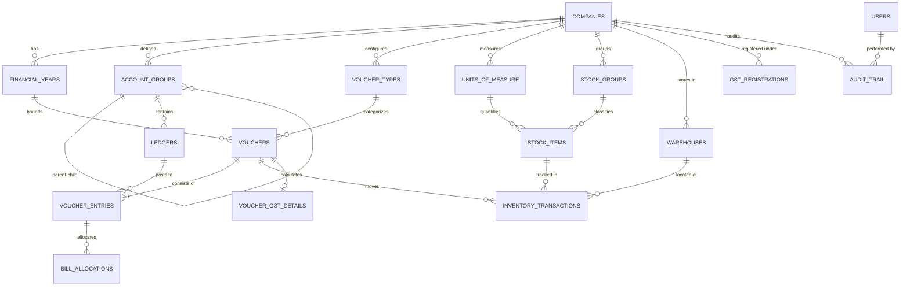

# Database Architecture & Design Specification

**Application**: Independent Clean-Room Accounting Application  
**Target Platform**: Desktop (Tauri + Rust + TypeScript)  
**Database Engine**: SQLite 3 (Local-First Deployment)  
**Version**: 1.0.0  
**Date**: October 22, 2026  
**Compliance Standard**: Clean-Room Accounting Specification ([`CLEAN_ROOM_SPEC.md`](file:///d:/Tally/CLEAN_ROOM_SPEC.md))

---

## 1. Architectural Strategy & Design Principles

### 1.1 Local-First SQLite Strategy
1. **Decoupled File per Company Model**:
   * Each company operates in its own isolated SQLite database file: `data/companies/{company_number}.db` (e.g., `10001.db`).
   * A lightweight global database `data/system.db` maintains the company catalog, user authentication credentials, and system settings.
   * **Benefit**: Zero cross-tenant leakage, instantaneous single-company backups, simple file copying, and independent schema migration per company.
2. **ACID Transactions**:
   * SQLite runs in `WAL` mode (Write-Ahead Logging) with `PRAGMA synchronous = NORMAL` and `PRAGMA foreign_keys = ON`.
   * Multi-statement voucher postings execute inside explicit Rust-managed transactions (`BEGIN IMMEDIATE ... COMMIT`).

### 1.2 Decimal-Safe Monetary Arithmetic
* **The Problem**: Standard IEEE-754 floating point types (`REAL` / `FLOAT`) cause rounding discrepancies in financial systems (e.g., $0.1 + 0.2 \ne 0.3$).
* **The Solution**: 
  * All currency amounts are stored as **64-bit signed integers in minor units** (Paise for INR, Cents for USD).
  * Storage field: `amount_paise BIGINT NOT NULL` (e.g., ₹1,250.75 is stored as `125075`).
  * 64-bit integer range supports up to $\pm 9.22 \times 10^{18}$ paise ($\approx \pm ₹92$ quadrillion), fully preventing overflow while guaranteeing exact integer arithmetic.
  * In Rust, calculations use `rust_decimal::Decimal` or integer math before persisting to SQLite.
  * Quantities are stored as integers in **milli-units** (`quantity_milli INTEGER NOT NULL`, where $1.500\text{ kg} = 1500$) with a corresponding `decimal_places` setting on the Unit of Measure.

### 1.3 Debit-Credit Balance Invariance
* A voucher cannot be posted unless the sum of debits equals the sum of credits.
* Enforced via **two defense-in-depth layers**:
  1. **Rust Application Layer**: Validates $\sum \text{Dr} = \sum \text{Cr}$ before issuing `COMMIT`.
  2. **SQLite Database Trigger Layer**: An `AFTER UPDATE OF status` trigger verifies that if a voucher's status transitions to `'Posted'`, the sum of its debits minus credits equals zero, rejecting the transaction with `RAISE(ABORT, ...)` otherwise.

### 1.4 Immutability & Anti-Silent-Modification
* Vouchers operate on a state machine: `Draft` $\to$ `Posted` $\to$ `Cancelled`.
* Once a voucher is marked `Posted`:
  * A database trigger prevents direct updates to amounts, ledgers, or voucher numbers.
  * Adjustments must be performed by posting a compensating voucher (Credit Note, Debit Note, or Journal Reversal) or by marking the voucher `Cancelled` through an explicit cancellation command that logs the prior state into the immutable audit trail.
* The `audit_trail` table contains an `AFTER UPDATE OR DELETE` trigger that unconditionally raises an abort exception, ensuring tamper-evidence compliant with MCA audit trail regulations.

---

## 2. Entity-Relationship Model (ERD)



---

## 3. Detailed Schema Domain Breakdown

### 3.1 Company & Period Management
* `companies`: Root settings, legal names, registration numbers (PAN, CIN), base currency parameters.
* `financial_years`: Explicit FY boundaries (`fy_start_date`, `fy_end_date`) and `books_beginning_date`.

### 3.2 Chart of Accounts
* `account_groups`: Hierarchical categories with nature (`Asset`, `Liability`, `Income`, `Expense`) and indicator whether they affect Gross Profit (`affects_gross_profit`).
* `ledgers`: The fundamental unit of financial posting. Carries `opening_balance_paise`, bill-wise tracking flags, and party tax attributes (GSTIN, State).

### 3.3 Transaction Subsystem
* `voucher_types`: Configuration for standard voucher classes (Contra, Payment, Receipt, Journal, Sales, Purchase, Debit Note, Credit Note) with auto-numbering prefixes and rules.
* `vouchers`: Header table holding transaction date, voucher number, reference details, status (`Draft`, `Posted`, `Cancelled`), and total amount.
  * **Composite Unique Constraint**: `(company_id, fy_id, voucher_type_id, voucher_number)`.
* `voucher_entries`: Individual debit or credit line items.
* `bill_allocations`: Sub-ledger allocation tracking unpaid bills (`NewRef`), bill settlements (`AgstRef`), advances, and payments on account.

### 3.4 Inventory Subsystem
* `units_of_measure`: Base and compound units with decimal precision controls.
* `stock_groups` & `stock_categories`: Multilevel classification of items.
* `warehouses`: Physical godowns / locations.
* `stock_items`: SKU master with valuation method (`FIFO`, `WeightedAverage`, `LastPurchaseCost`, `StandardCost`), tax rate, and opening inventory.
* `inventory_transactions`: Inward and outward stock movement records linked directly to the parent voucher and ledger line.

### 3.5 Indian GST Compliance
* `gst_registrations`: Company GSTINs and registration classifications (Regular / Composition).
* `hsn_sac_directory`: Statutory HSN/SAC master with standard GST rates.
* `voucher_gst_details`: Transaction-level Place of Supply (POS), inter-state flags, RCM indicators, and statutory document tracking (E-Way bill numbers, IRN hashes).

### 3.6 Users, Security & MCA Audit Trail
* `users`: Authentication records, password hashes (Argon2id), roles (`Admin`, `Accountant`, `DataEntry`, `Auditor`).
* `audit_trail`: Chained, tamper-evident log containing before/after JSON snapshots, UTC timestamps, user IDs, and SHA-256 cryptographic hashes.
* `backup_metadata`: Manifest records tracking archive generations and package digests.

---

## 4. Integrity Constraints & Triggers

### 4.1 Enforcing Double-Entry Balance
A SQLite trigger validates balance before committing a voucher to `Posted` status:

```sql
CREATE TRIGGER trg_verify_voucher_balance_on_post
BEFORE UPDATE OF status ON vouchers
FOR EACH ROW
WHEN NEW.status = 'Posted'
BEGIN
    SELECT CASE
        WHEN (
            SELECT COALESCE(SUM(CASE WHEN entry_type = 'Dr' THEN amount_paise ELSE -amount_paise END), -1)
            FROM voucher_entries
            WHERE voucher_id = NEW.voucher_id
        ) != 0
        THEN RAISE(ABORT, 'ERR_VOUCHER_UNBALANCED: Total Debits must exactly equal Total Credits before posting.')
    END;
END;
```

### 4.2 Preventing Modification of Posted Vouchers
```sql
CREATE TRIGGER trg_prevent_posted_voucher_update
BEFORE UPDATE ON vouchers
FOR EACH ROW
WHEN OLD.status = 'Posted' AND NEW.status = 'Posted'
BEGIN
    SELECT CASE
        WHEN OLD.total_amount_paise != NEW.total_amount_paise 
          OR OLD.voucher_date != NEW.voucher_date
          OR OLD.voucher_number != NEW.voucher_number
          OR OLD.voucher_type_id != NEW.voucher_type_id
        THEN RAISE(ABORT, 'ERR_POSTED_VOUCHER_IMMUTABLE: Posted vouchers cannot be modified. Cancel or reverse with a credit/debit note.')
    END;
END;

CREATE TRIGGER trg_prevent_posted_line_mutation
BEFORE INSERT ON voucher_entries
FOR EACH ROW
WHEN (SELECT status FROM vouchers WHERE voucher_id = NEW.voucher_id) = 'Posted'
BEGIN
    SELECT RAISE(ABORT, 'ERR_POSTED_VOUCHER_IMMUTABLE: Cannot add lines to an already posted voucher.');
END;
```

### 4.3 Tamper-Evident Audit Trail Immutability
```sql
CREATE TRIGGER trg_audit_trail_immutable_update
BEFORE UPDATE ON audit_trail
FOR EACH ROW
BEGIN
    SELECT RAISE(ABORT, 'ERR_AUDIT_TAMPERING: Audit trail entries cannot be updated under MCA compliance.');
END;

CREATE TRIGGER trg_audit_trail_immutable_delete
BEFORE DELETE ON audit_trail
FOR EACH ROW
BEGIN
    SELECT RAISE(ABORT, 'ERR_AUDIT_TAMPERING: Audit trail entries cannot be deleted under MCA compliance.');
END;
```

---

## 5. Performance Indexes & Query Optimization

| Index Name | Target Table | Columns | Optimized Query Pattern |
| :--- | :--- | :--- | :--- |
| `idx_vouchers_lookup` | `vouchers` | `(company_id, fy_id, voucher_type_id, voucher_date)` | Date register and Day Book queries |
| `idx_voucher_entries_ledger` | `voucher_entries` | `(ledger_id, entry_type, amount_paise)` | General Ledger drilldown & balance computation |
| `idx_bill_alloc_unpaid` | `bill_allocations` | `(ledger_id, ref_name, ref_type)` | Outstanding bills and aging reports |
| `idx_inv_tx_item_date` | `inventory_transactions` | `(item_id, movement_type, warehouse_id)` | Stock summary and FIFO lot consumption |
| `idx_audit_entity` | `audit_trail` | `(company_id, entity_type, entity_id)` | Entity history and audit inspector view |

---

## 6. Unresolved Database Decisions

Before finalizing the application layer, the following design decisions require confirmation:

1. **Database Mode: Single-Tenant vs Multi-Tenant per File**:
   * *Adopted Baseline*: One SQLite file per company (`{company_number}.db`).
   * *Alternative*: All companies in a single database with `company_id` on every table.
   * *Recommendation*: Retain the one-file-per-company model for alignment with desktop accounting practices (easy email sharing, instant point-in-time backup).
2. **Rounding Method for GST Split Fractions**:
   * When an item has an odd tax amount (e.g., ₹1.05 total GST), splitting into 50% CGST and 50% SGST yields ₹0.525 each.
   * *Decision*: Specify round-half-up at item line level or aggregate voucher level.
3. **Compound Unit Hierarchy Depth**:
   * Whether to support arbitrary nested compound units (e.g., Box $\to$ Carton $\to$ Case) or limit to 2-tier conversions ($1\text{ Box} = 10\text{ Nos}$).
