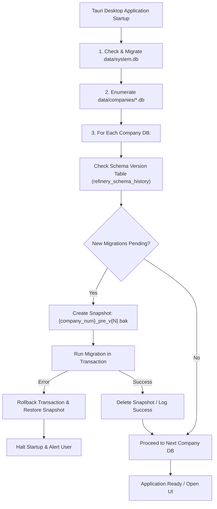

# Database Migration & Deployment Plan

**Application**: Independent Clean-Room Accounting Application  
**Target Platform**: Desktop (Tauri v2 + Rust + SQLite 3)  
**Migration Engine**: Embedded Rust Migration Runner (`refinery` / `sqlx-sqlite`)  
**Version**: 1.0.0  
**Date**: October 22, 2026  

---

## 1. Migration Strategy & Architecture

### 1.1 Local-First Multi-Database Architecture
Because each company resides in its own discrete SQLite file (`data/companies/{company_number}.db`), migrations must run **per company file** plus on the central `data/system.db`.



### 1.2 Tooling Selection
* **Rust Library**: [`refinery`](https://crates.io/crates/refinery) or [`sqlx`](https://crates.io/crates/sqlx) embedded migrations.
* **Storage Location**: Migrations are compiled directly into the Rust binary using `embed_migrations!("migrations")`.
* **Zero External Dependencies**: End users never install or run external CLI tools; migration runs automatically during app launch.

---

## 2. Migration Versioning Convention

Migrations reside in `src-tauri/migrations/` following the strict sequential naming standard:

```
src-tauri/migrations/
├── V001__initial_schema.sql
├── V002__seed_standard_chart_of_accounts.sql
├── V003__add_composite_indexes.sql
└── V004__mca_audit_trail_triggers.sql
```

### Format Specification:
* `V{VERSION}__{description}.sql`
* `VERSION`: 3-digit zero-padded integer (`001`, `002`, `003`...).
* `description`: Lowercase snake_case summary of changes.

---

## 3. Pre-Migration Safeguards & Rollback Protocol

Before applying any migration to a company database:

1. **Exclusive Lock Acquisition**:
   * Acquire an exclusive SQLite lock (`BEGIN IMMEDIATE;` or `PRAGMA locking_mode = EXCLUSIVE;`).
2. **Atomic Pre-Migration Snapshot**:
   * Copy `{company_number}.db` to `{company_number}.db.pre_migration_v{VERSION}.bak`.
3. **Foreign Key Integrity Check**:
   * Run `PRAGMA foreign_key_check;` before and after migration execution.
4. **Failure Recovery**:
   * If any SQL statement errors out:
     1. Issue `ROLLBACK;`.
     2. Close database connection.
     3. Overwrite `{company_number}.db` from the `.bak` file.
     4. Display an alert modal in Tauri explaining the migration failure with detailed logs.

---

## 4. Rust Migration Runner Implementation (Tauri Setup Hook)

```rust
// src-tauri/src/db/migrator.rs
use refinery::embed_migrations;
use rusqlite::Connection;
use std::fs;
use std::path::{Path, PathBuf};

embed_migrations!("migrations");

pub fn migrate_company_database(db_path: &Path) -> Result<(), Box<dyn std::error::Error>> {
    let mut conn = Connection::open(db_path)?;
    conn.execute_batch("PRAGMA foreign_keys = ON; PRAGMA journal_mode = WAL;")?;

    // Create automatic pre-migration backup snapshot
    let backup_path = db_path.with_extension("migration_backup");
    fs::copy(db_path, &backup_path)?;

    // Run embedded migrations
    match migrations::runner().run(&mut conn) {
        Ok(report) => {
            println!("Applied {} migrations to {:?}", report.applied_migrations().len(), db_path);
            let _ = fs::remove_file(backup_path); // Cleanup backup on success
            Ok(())
        }
        Err(e) => {
            eprintln!("Migration failed on {:?}: {}. Restoring backup...", db_path, e);
            drop(conn);
            fs::copy(&backup_path, db_path)?;
            let _ = fs::remove_file(&backup_path);
            Err(Box::new(e))
        }
    }
}
```

---

## 5. Initial Migration Scripts Breakdown

### `V001__initial_schema.sql`
* Creates core 22 tables: `companies`, `financial_years`, `account_groups`, `ledgers`, `voucher_types`, `vouchers`, `voucher_entries`, `bill_allocations`, `sales_purchase_details`, `units_of_measure`, `stock_groups`, `stock_categories`, `warehouses`, `stock_items`, `inventory_transactions`, `gst_registrations`, `hsn_sac_directory`, `voucher_gst_details`, `users`, `audit_trail`, `backup_metadata`.
* Creates integrity triggers:
  * `trg_verify_voucher_balance_on_post`
  * `trg_prevent_posted_voucher_update`
  * `trg_prevent_posted_line_insert`
  * `trg_audit_trail_immutable_update`
  * `trg_audit_trail_immutable_delete`

### `V002__seed_standard_chart_of_accounts.sql`
* Inserts the statutory 28 accounting groups:
  * Primary: Capital Account, Loans (Liability), Current Liabilities, Fixed Assets, Investments, Current Assets, Branch / Divisions, Misc. Expenses, Sales Accounts, Purchase Accounts, Direct Incomes, Indirect Incomes, Direct Expenses, Indirect Expenses.
  * Secondary: Bank Accounts, Cash-in-hand, Sundry Debtors, Sundry Creditors, Duties & Taxes, Provisions, Stock-in-hand, Bank OD, Secured Loans, Unsecured Loans, Deposits (Asset), Loans & Advances (Asset).
* Seeds initial HSN/SAC directory table with common GST rate slabs.

---

## 6. Reproducible Development & Testing Setup

### 6.1 Prerequisites
* **Rust**: `1.75+` (`cargo`, `rustc`)
* **Node.js**: `20.x+` (`npm`)
* **SQLite 3**: Native SQLite 3 runtime

### 6.2 Setup Commands

```bash
# 1. Clone repository
git clone https://github.com/organization/accounting-app.git
cd accounting-app

# 2. Install frontend dependencies
npm install

# 3. Compile and run migrations against test database
cd src-tauri
cargo run --bin migrate_dev

# 4. Run automated test suite
cargo test --test db_integration_tests

# 5. Launch Tauri desktop app in dev mode
cargo tauri dev
```

### 6.3 Database Reset Utility (`reset_dev_db`)

```bash
# Reset local test database to clean seed state
cargo run --bin reset_test_db -- --company 10001
```
This utility removes `data/companies/10001.db`, re-runs all migrations, and loads clean sample fixtures (1 company, 1 financial year, 25 ledgers, 10 inventory items).
