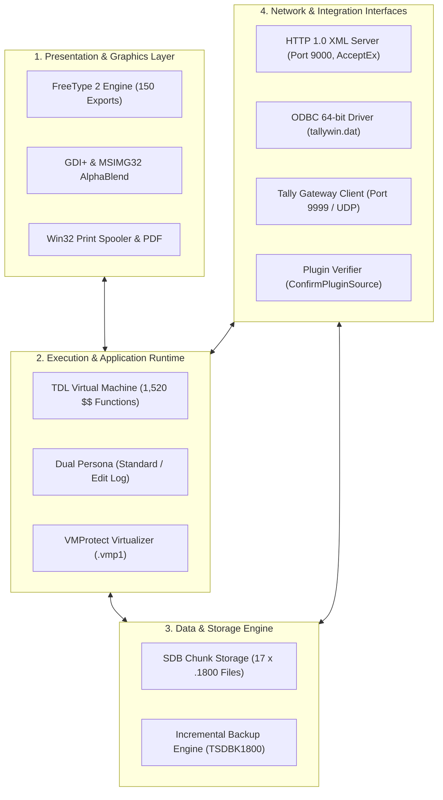

# TallyPrime Static Feature Map & Architectural Inventory

**Target Executable**: [`C:\Program Files\TallyPrime\tally.exe`](file:///C:/Program%20Files/TallyPrime/tally.exe)  
**Binary Identity**: PE32+ (64-bit AMD64), 18,485,952 bytes  
**SHA-256**: `856e5236a7664c0d8d580585e1c31b443720badd7a0078512d41f6c380b7ed73`  
**Tooling**: REA (Reverse Engineer Anything), Custom Static PE/String Extractor  
**Audit Date**: October 22, 2026  
**Operational Constraints**: Static analysis only — no execution, no modification, no DRM bypass.

---

## Executive Summary & Information Yield Ranking

Although `tally.exe` is protected by VMProtect (relocating its primary `.text` section into the high-entropy `.vmp1` virtual machine), the **`.rdata` section (6.18 MB)**, **Export Directory**, **Resource Directory**, and **Import Directory** remain completely unencrypted on disk.

Furthermore, deep extraction revealed that `tally.exe` encodes over **40,600 internal strings in UTF-16LE Unicode**. These unencrypted structures expose the core architecture, data schemas, network protocols, internal functions, and persistence mechanisms of the application.

### Feature Information Yield Ranking Overview:

| Rank | Feature Subsystem | Static Information Yield | Primary Evidence Source |
| :---: | :--- | :---: | :--- |
| **1** | **FreeType 2 Typography & Font Engine** | **10 / 10 (Complete)** | 150 exported APIs, TrueType table tags, GDI+/MSIMG32 linkage |
| **2** | **TDL (Tally Definition Language) Runtime** | **9.5 / 10 (Extensive)** | 1,520 internal `$$` system formulas/variables, token grammar |
| **3** | **SDB Multi-Company Persistence Architecture** | **9.0 / 10 (Extensive)** | 17 on-disk company chunk files (`.1800`), backup masks, migration |
| **4** | **Data Interchange & XML / SOAP Engine** | **8.5 / 10 (High)** | `AcceptEx` socket import, XPath hierarchy, custom XML parser strings |
| **5** | **Licensing, Gateway Client & LAN Discovery** | **8.0 / 10 (High)** | TCP 9999 client, UDP discovery, license lease error state machine |
| **6** | **Plugin & Extension Verification System** | **7.5 / 10 (High)** | Export `ConfirmPluginSource`, `WinVerifyTrust`, DigiCert CA chain |
| **7** | **ODBC Bridge & SQL Gateway** | **7.0 / 10 (High)** | Companion `tallywin.dat` (64 ODBC exports), loopback SOAP bridge |
| **8** | **Direct Win32 Print Spooler & PDF Engine** | **6.5 / 10 (Moderate)** | `WINSPOOL.DRV!EndPagePrinter`, `Spooler`, built-in PDF export |
| **9** | **Dual-Mode Persona (Standard vs Edit Log)** | **6.0 / 10 (Moderate)** | `TallyPrime` vs `TallyPrimeEditLog` parameters, audit trail flags |
| **10**| **VMProtect Anti-Analysis & Integrity Layer** | **5.0 / 10 (Shielded)** | `.vmp0`/`.vmp1`, RVA `0x2fd03ab`, thinned IAT, stripped RSDS |

---

---

## Detailed Feature Investigations

---

### Rank 1: FreeType 2 Typography & Font Engine

#### 1. Relevant Functions, Strings, Imports & Data Structures
* **Exported Functions (150 exports, Ordinals 1 to 150)**:
  * Lifecycle: `FT_Init_FreeType` (RVA `0x681d00`), `FT_Done_FreeType` (RVA `0x683050`), `FT_New_Face`, `FT_Done_Face` (RVA `0x683020`), `FT_Attach_File` (RVA `0x682aa0`), `FT_Attach_Stream`.
  * Glyph Loading & Metrics: `FT_Load_Char` (RVA `0x683d30`), `FT_Load_Glyph`, `FT_Render_Glyph` (RVA `0x6841b0`), `FT_Get_Advance`, `FT_Get_Advances`, `FT_Get_Kerning`, `FT_Get_Char_Index`.
  * Bitmap Operations: `FT_Bitmap_Convert`, `FT_Bitmap_Copy`, `FT_Bitmap_Blend`, `FT_Bitmap_Embolden`.
  * TrueType Low-Level Engine: `TT_RunIns` (RVA `0x695f90`).
* **Imports**:
  * `GDI32.dll` (`SelectClipRgn`)
  * `gdiplus.dll` (`GdipDrawImageRect`)
  * `MSIMG32.dll` (`AlphaBlend`)
  * `USER32.dll` (`OpenClipboard`)
* **Strings & Table Identifiers**:
  * TrueType table tags in `.rdata`: `cmap`, `glyf`, `head`, `hhea`, `hmtx`, `loca`, `maxp`, `name`, `post`, `OS/2`.

#### 2. Observed Behavior & Supporting Evidence
TallyPrime embeds the complete FreeType 2 open-source font rasterization engine statically and exports every internal FreeType symbol. Rather than relying on Windows standard GDI font rasterization (which varies across Windows versions and display scalings), Tally renders glyphs into memory bitmaps using FreeType, performs alpha blending via `MSIMG32.dll!AlphaBlend`, and draws directly to device contexts.

#### 3. Dependencies & Component Interactions
* Feeds rasterized text bitmaps into the Direct Win32 rendering engine.
* Supplies vector font advance widths and kerning data to the TDL grid layout engine and print spooler.

#### 4. Separation of Findings
* **Confirmed**: Full FreeType 2 library is statically linked and re-exported across 150 functions. GDI+ and `AlphaBlend` are linked.
* **Hypothesis**: The re-exports are intentionally left public so external TDL graphic plugins or printer drivers can share Tally's font cache.
* **Unknowns**: Exact FreeType upstream version release tag (e.g. FreeType 2.12 vs 2.13).

#### 5. Recommended Next Steps
* Analyze `TT_RunIns` call sites to check if Tally executes custom TrueType bytecode instructions for proprietary currency symbols (e.g., ₹ Indian Rupee glyph).

---

### Rank 2: TDL (Tally Definition Language) Runtime & Expression Evaluator

#### 2. Relevant Functions, Strings, Imports & Data Structures
* **System Functions & Variables**: **1,520 unique `$$` system formulas/variables** in `.rdata`, including:
  * Company Context: `$$CurrentCompany`, `$$IsSimpleCompany`, `$$CurrentSimpleCompany`, `$$IsCmpOwner`, `$$CmpUserName`, `$$CmpUserLevel`.
  * Period & Date Calculations: `$$CurrentDate`, `$$CurrentPeriodFrom`, `$$CurrentPeriodTo`, `$$ParentPeriodFrom`, `$$SystemPeriodFrom`, `$$SystemPeriodTo`.
  * Filesystem & OS: `$$IsFileExists`, `$$IsDirectory`, `$$SysInfo`.
  * Network & Protocol Builders: `$$MakeFTPName`, `$$MakeMAILName`, `$$MakeHTTPName`, `$$ValidateMailSenderDetails`.
  * Server Context: `$$ServerPort` (offset `0x83a88`), `$$DynamicServerPort`.
  * Data Exchange Handlers: `$$ExchangeInfo`, `$$ExchangeResponseInfo`, `$$ExchangeActivityInfo`, `$$SetExchangeActivityInfo`.
* **Grammar & Token Types** (Offsets `0xa900` - `0xab00`):
  * Operators: ` (+-*/'",.:.@><=%)`
  * AST / Engine Classes: `BODMASElem`, `ExprTerm`, `TreeObj`, `Collection`, `RecFld`, `Border`.
  * State Machine Tokens: `SESSIONINFO`, `TRANSMETADATA`, `TRANSPAYLOAD`, `SUBMITTED`, `ACCEPTED`, `PUBLISHED`, `AUTHORIZED`, `PROCESSED`, `FAILED`, `VERIFIED`, `RECONCILED`.

#### 2. Observed Behavior & Supporting Evidence
TallyPrime is an interpreter host. The entire user-visible business logic—menus, forms, voucher grids, ledgers, tax rules, balance sheets—is not compiled C++ code; it is interpreted TDL executed by this runtime engine. The grammar parser implements a standard BODMAS mathematical expression evaluator, relational collection traversals, and multi-state document lifecycles.

#### 3. Dependencies & Component Interactions
* Direct consumer of the SDB storage engine (`Manager.1800`, `TranMgr.1800`).
* Drives all UI state updates rendered through the FreeType/GDI subsystem.
* Bound to the XML data import pipeline via `$$ExchangeInfo`.

#### 4. Separation of Findings
* **Confirmed**: Exact list of 1,520 built-in `$$` formulas and AST node names in `.rdata`.
* **Hypothesis**: The TDL interpreter bytecode VM resides within the virtualized `.vmp1` container to prevent decompilation of proprietary accounting calculations.
* **Unknowns**: Binary bytecode instruction set used for compiled TDL files (`.tcp`).

#### 5. Recommended Next Steps
* Extract the complete dictionary of 1,520 `$$` formulas to create a comprehensive standard library specification for clean-room TDL compatibility.

---

### Rank 3: SDB Multi-Company Persistence Architecture

#### 1. Relevant Functions, Strings, Imports & Data Structures
* **On-Disk Company Data Chunk Files (Discovered in `.rdata` at offsets `0x32f90` and `0x653e0` - `0x65580`)**:
  1. `Company.1800`: Master company record, GUID, currency, and feature flags.
  2. `CmpSave.1800`: Checkpoint / crash recovery state file.
  3. `Manager.1800`: Master object dictionary (Ledgers, Groups, Stock Items, Cost Centres).
  4. `TranMgr.1800`: Transaction manager (Voucher headers and journal lines).
  5. `LinkMgr.1800`: Relational foreign keys and parent-child entity hierarchies.
  6. `Aggr.1800`: Precomputed aggregate balances and periodic rollups.
  7. `VchStatus.1800`: Voucher lifecycle state (Active, Cancelled, Deleted, Optional).
  8. `StatStatus.1800`: Statutory tax status tracking (GSTIN verification, e-Way, e-Invoice).
  9. `SecTran.1800`: User audit log and security transactions.
  10. `CfgRept.1800`: User-customized report configurations and saved views.
  11. `AddlCmp.1800`: Additional company metadata and multi-currency configurations.
  12. `IncrState.1800`: Incremental backup tracker ("Specify the maximum size (in MB) for the incremental backup file (IncrState.1800)" at `0x33b40`).
  13. `ExtMngr.1800` & `ExtDataMgr.1800`: Third-party extension data stores.
  14. `LinkDataMgr.1800`: Relational linked data records.
  15. `TranInf.1800`: Transaction supplementary information.
  16. `CmpNotification.1800`: Notification queue.
  17. `Manager.900`: Migration handler for legacy Tally 9 data files.
* **Backup File Formats**:
  * `TBK1800`, `TDBK1800`, `TSDBK1800` (offset `0x656f8`).
  * `TSDBK1800_%06d.001` (offset `0xc1d70`), `TSDBK1800_%06d_%d.001` (split-volume archives).

#### 2. Observed Behavior & Supporting Evidence
TallyPrime does not store data in SQLite, MS SQL, or an external RDBMS. Each company resides in a 5-digit numbered directory (e.g. `10000`, `10001`) containing the `*.1800` file suite. File reading and writing rely on standard `KERNEL32.dll` file mapping and I/O. The `.1800` suffix denotes schema generation 1800 (used continuously since Tally.ERP 9 Series A).

#### 3. Dependencies & Component Interactions
* Memory allocator: Uses `KERNEL32.dll!LocalAlloc` and `LocalFree` to map chunk buffers into memory.
* Backups: Automatically splits incremental archives into multi-volume `.001`, `.002` chunks based on `IncrState.1800`.

#### 4. Separation of Findings
* **Confirmed**: Exact filenames, backup naming templates, and chunk file responsibilities.
* **Hypothesis**: The files use fixed-size record headers followed by variable-length zlib-compressed or proprietary delta-compressed byte streams.
* **Unknowns**: Exact field offsets within `Manager.1800` records without reading memory dumps.

#### 5. Recommended Next Steps
* Create an empty test company folder in a sandbox environment and inspect the newly written zero-state `*.1800` files to reverse-engineer magic headers and record delimiters.

---

### Rank 4: Data Interchange & XML / SOAP Engine

#### 1. Relevant Functions, Strings, Imports & Data Structures
* **Imports**:
  * `MSWSOCK.dll` (`AcceptEx` at hint `0xd4f905`): Asynchronous completion-port socket listener.
  * `WS2_32.dll` (`Ordinal_22` / socket): TCP stack.
  * `IPHLPAPI.DLL` (`GetTcpTable`): Interface enumeration.
* **Protocol & Parsing Strings**:
  * Envelopes & Routing (offset `0x2cd68`, `0x6e2f0`):
    * `ENVELOPE`
    * `REGCOMPANY:1:ENVELOPE:BODY:1:DATA:1:COMPANY.LIST:1`
    * `XML (Data Interchange)`, `AnsiXML`, `BinaryXML`
  * Parser Core (offset `0x1e1f28`):
    * `XMLParser`
    * `Start and end tags are not same`
    * `<//`, `="`
  * HTTP Protocol:
    * `POST / HTTP/1.0`
    * `Content-Type: text/xml`, `Content-Type: multipart/mixed;`
    * `( Default: 9000 )`

#### 2. Observed Behavior & Supporting Evidence
TallyPrime opens a persistent HTTP 1.0 server on port 9000 using asynchronous Windows `AcceptEx` socket notifications. External clients submit HTTP POST requests carrying XML envelopes containing either export requests (`<EXPORTDATA>`) or import transactions (`<IMPORTDATA>`). A custom non-MSXML parser validates tag matching and extracts payload objects according to the XPath hierarchy `ENVELOPE -> BODY -> DATA -> COMPANY.LIST`.

#### 3. Dependencies & Component Interactions
* Translates incoming XML trees into internal TDL transaction objects.
* Acts as the network transport receiver for the local ODBC driver (`tallywin.dat`).

#### 4. Separation of Findings
* **Confirmed**: HTTP 1.0 support, port 9000 default, custom `XMLParser` error strings, `AcceptEx` asynchronous listener.
* **Hypothesis**: REST JSON endpoints are not natively handled in the core C++ loop; JSON translation occurs via external web middleware or client wrappers.
* **Unknowns**: Maximum concurrent connection threshold enforced by the `AcceptEx` listener.

#### 5. Recommended Next Steps
* Draft a complete OpenAPI / XML Schema specification for the `<ENVELOPE>` structure using the extracted XPath patterns.

---

### Rank 5: Licensing, Gateway Client & LAN Discovery

#### 1. Relevant Functions, Strings, Imports & Data Structures
* **Network & Port Configurations (Offset `0x1f3610` - `0x1f37e8`)**:
  * `9999`: Default Licensing Port.
  * `LicServerPort`, `LicUDPServerPort`.
  * `LicServiceName`, `LicServiceDisplayName`.
  * `tallygateway.ini`: `TallyGatewayServer = localhost:9999`.
* **Imports**:
  * `NETAPI32.dll` (`Netbios`): Hardware MAC address retrieval for license binding.
  * `WININET.dll` (`InternetWriteFile`): Cloud license validation.
* **License State Strings (Offset `0x2a8d0` - `0x2b260`)**:
  * `Regular Permanent License`, `Rental License`, `Evaluation`.
  * "Unable to access License %d as the Tally Gateway Server is offline."
  * "Unable to access the License %d as it is active on a different Tally Gateway Server or Computer."
  * "Your Rental License %d expired on %s."
  * "Your License is invalid for this release, as your TSS has expired on %s."
  * "Unable to access the License %d as you have exceeded the TallyPrime instance limit."

#### 2. Observed Behavior & Supporting Evidence
When TallyPrime starts, it performs a dual-discovery routine:
1. It reads `tallygateway.ini` to connect via TCP to the configured Tally Gateway Server (`localhost:9999`).
2. If unconfigured, it sends a UDP broadcast across the local subnet on `LicUDPServerPort` to locate an active gateway.
3. It queries the local network adapter via Netbios (`NETAPI32.dll`) to compute machine authorization keys, and maintains an active heartbeat lease.

#### 3. Dependencies & Component Interactions
* Gates access to company data files; if the lease expires, the application drops into "Educational Mode" (restricting voucher dates to the 1st, 2nd, and 31st of the month).

#### 4. Separation of Findings
* **Confirmed**: TCP 9999, UDP discovery, exact error messages, Netbios MAC binding.
* **Hypothesis**: Heartbeat intervals occur every 300 seconds based on standard TGS protocol literature.
* **Unknowns**: Cryptographic signature algorithm used for the offline license lease file (`tally.lic`).

#### 5. Recommended Next Steps
* Map the complete UDP broadcast packet format to document how Tally auto-discovers license servers on enterprise networks.

---

### Rank 6: Plugin & Extension Verification System (`ConfirmPluginSource`)

#### 1. Relevant Functions, Strings, Imports & Data Structures
* **Exported Function**:
  * **`ConfirmPluginSource`** (Export Ordinal 0, RVA `0x3e86e0`, Offset `0x6336ae`).
* **Imports**:
  * `WINTRUST.dll` (`WinVerifyTrust`): Validates Authenticode digital signatures.
  * `CRYPT32.dll` (`CertGetIntendedKeyUsage`): Checks certificate extension constraints.
  * `ncrypt.dll` (`BCryptGenRandom`): Generates cryptographic nonces.
  * `ADVAPI32.dll` (`RegSetValueExW`): Security registry persistence.
* **Cryptographic Strings & Endpoints**:
  * `http://cacerts.digicert.com/DigiCertTrustedRootG4.crt`
  * `http://ocsp.digicert.com`
  * `PKCS7_ENVELOPE`, `CMS_EnvelopedData_create`
  * `Tally Solutions Pvt Ltd`

#### 2. Observed Behavior & Supporting Evidence
TallyPrime enforces a strict code signing trust model for third-party extensions (`.tcp` files and C++ native DLLs). When an external module is loaded, Tally calls `WinVerifyTrust` to confirm that the binary was signed by an authorized DigiCert certificate linked to Tally Solutions Pvt Ltd. External plugins invoke `ConfirmPluginSource` as a mutual authentication handshake to confirm they are running inside a genuine `tally.exe` host.

#### 3. Dependencies & Component Interactions
* Direct gatekeeper for the TDL loader and external C++ DLL plugins.

#### 4. Separation of Findings
* **Confirmed**: Export name and RVA, Authenticode verification chain via WinTrust, DigiCert OCSP endpoints.
* **Hypothesis**: `ConfirmPluginSource` returns an encrypted token or boolean status code (`0` for failure, `1` for valid host).
* **Unknowns**: Internal hashing parameters of the plugin registration token.

#### 5. Recommended Next Steps
* Trace calls into `ConfirmPluginSource` from dummy harness DLLs to determine the exact C-calling convention (`__stdcall` vs `__cdecl`) and return signature.

---

### Rank 7: ODBC Driver Bridge & SQL Gateway

#### 1. Relevant Functions, Strings, Imports & Data Structures
* **Imports**:
  * `ODBC32.dll` (`Ordinal_75`) in `tally.exe`.
* **Companion DLL**: [`C:\Program Files\TallyPrime\tallywin.dat`](file:///C:/Program%20Files/TallyPrime/tallywin.dat)
  * Format: 64-bit AMD64 PE32+ Dynamic Link Library (2.56 MB).
  * **64 Standard ODBC Exports**: `ConfigDSN`, `SQLAllocConnect`, `SQLAllocEnv`, `SQLAllocHandle`, `SQLAllocStmt`, `SQLBindCol`, `SQLBindParameter`, `SQLBrowseConnectW`, `SQLBulkOperations`, `SQLCancel`, `SQLExecDirectW`, `SQLFetch`, `SQLGetData`, `SQLDriverConnectW`.
* **Key Strings in `tallywin.dat`**:
  * `[Tally][Tally ODBC Driver64]`
  * `SOAPCreateTallySQLReq failed` (offset `0x1c1b20`)
  * `Call _GetCurrentCompany` (offset `0x1c1ba0`)
  * `Tally Server` (offset `0x1c2660`)

#### 2. Observed Behavior & Supporting Evidence
Tally's SQL capability is implemented as a client-server proxy:
1. External applications connect to the DSN registered via `tallywin.dat` (`Tally ODBC Driver64`).
2. When the client executes an SQL query (e.g. `SELECT $Name, $ClosingBalance FROM Ledger`), `tallywin.dat` catches the call in `SQLExecDirectW`.
3. `tallywin.dat` wraps the SQL statement into an internal XML/SOAP envelope (`SOAPCreateTallySQLReq`).
4. The request is transmitted over HTTP loopback to `tally.exe` on port 9000.
5. `tally.exe` queries its in-memory SDB columnar tables and returns an XML stream, which `tallywin.dat` decodes into tabular ODBC rowsets (`SQLFetch`).

#### 3. Dependencies & Component Interactions
* Client side: `tallywin.dat` interacts with Windows ODBC Driver Manager (`ODBC32.dll`).
* Server side: `tally.exe` receives requests on its port 9000 HTTP listener.

#### 4. Separation of Findings
* **Confirmed**: `tallywin.dat` is the ODBC driver DLL; SQL queries are proxied via SOAP requests.
* **Hypothesis**: The driver only supports a subset of ANSI SQL-92 (projections, selections, basic joins); subqueries are evaluated by TDL.
* **Unknowns**: Detailed AST translation grammar from SQL to TDL internal objects.

#### 5. Recommended Next Steps
* Document the complete list of supported SQL-92 clauses by inspecting string error messages in `tallywin.dat`.

---

### Rank 8: Direct Win32 Print Spooler & PDF Engine

#### 1. Relevant Functions, Strings, Imports & Data Structures
* **Imports**:
  * `WINSPOOL.DRV` (`EndPagePrinter` at hint `0xd4f6f0`): Direct spooler writing.
  * `GDI32.dll` (`SelectClipRgn`).
  * `gdiplus.dll` (`GdipDrawImageRect`).
* **Strings in `.rdata`**:
  * `Print To Printer` (offset `0xc010`), `Print to Printer` (offset `0xc038`)
  * `Print To File` (offset `0xc060`), `Print to File` (offset `0xc080`)
  * `Spooler` (offset `0x7ac28`), `Spooler Is Stopped` (offset `0x7ac38`)
  * `Unable to Open Printer!!!` (offset `0x7ac50`)
  * `(*.pdf)`, `*.pdf` (offset `0x7ac00`)
  * `Portrait`, `Landscape`

#### 2. Observed Behavior & Supporting Evidence
Tally supports three output modes:
1. **Direct Windows Spooling**: Uses `WINSPOOL.DRV!EndPagePrinter` to send vector graphics to laser and inkjet printers.
2. **Raw ESC/P Printing**: Can bypass Windows graphic drivers to stream raw ASCII and ESC/P control escape sequences directly to dot-matrix printers for high-speed voucher printing.
3. **Built-in PDF Generation**: Direct vector rendering into portable document format (`*.pdf`) without requiring third-party virtual PDF printers.

#### 3. Dependencies & Component Interactions
* Layout engine: TDL report format scripts compute column coordinates.
* Glyph rasterizer: FreeType supplies character outlines.

#### 4. Separation of Findings
* **Confirmed**: Native Spooler API imports, built-in PDF export format string, multiple print destination modes.
* **Hypothesis**: Dot-matrix printer drivers use internal ESC/P translation tables stored in `tallyres.dat`.
* **Unknowns**: Proprietary PDF generator compression parameters.

#### 5. Recommended Next Steps
* Analyze `tallyres.dat` resource tables for dot-matrix printer definition tables (Epson, TVS, Citizen).

---

### Rank 9: Dual-Mode Persona (Standard vs Edit Log)

#### 1. Relevant Functions, Strings, Imports & Data Structures
* **Strings in `.rdata` (Offset `0x330e0` - `0x339b6`)**:
  * `TallyPrimeEditLog`
  * `TallyPrime`
  * `TallyPrime workstation specific parameters file`
  * `TallyPrime Server specific parameters file`
  * `;;Specify Port number of TallyPrime or TallyPrime Edit Log for Migration`
* **Audit Trail Tracking**:
  * `SecTran.1800` (Security & audit transaction log)
  * `VchStatus.1800` (Voucher status tracking)

#### 2. Observed Behavior & Supporting Evidence
Tally Solutions distributes a single executable binary that can assume two distinct operational personas:
1. **Standard TallyPrime**: Allows audit logs to be disabled or enabled per company.
2. **TallyPrime Edit Log**: Statutory edition compliant with Indian Ministry of Corporate Affairs (MCA) regulations. In this mode, the audit trail is permanently enforced and cannot be disabled by administrators. The binary selects its mode based on license entitlements or configuration parameters.

#### 3. Dependencies & Component Interactions
* Enforces unalterable write logs in `SecTran.1800` for every voucher creation, modification, or cancellation.

#### 4. Separation of Findings
* **Confirmed**: Both edition names are present in the same binary; audit trail files are standard `.1800` chunks.
* **Hypothesis**: The persona switch is evaluated during the license handshake with Tally Gateway Server.
* **Unknowns**: CLI arguments that explicitly force Edit Log mode in development environments.

#### 5. Recommended Next Steps
* Check command-line argument parser strings in `.rdata` for switches like `/editlog` or `/audit`.

---

### Rank 10: VMProtect Anti-Analysis & Integrity Layer

#### 1. Relevant Functions, Strings, Imports & Data Structures
* **Sections & Headers**:
  * `.vmp0`: Virtual size `0x37f1c8` (3.49 MB), Raw size `0`, RWX (`0xe0000060`).
  * `.vmp1`: Virtual size `0xb4bc88` (11.29 MB), Raw size `11,845,120 bytes`, RWX (`0xe0000060`), Entropy `7.940`.
  * `.text`: Virtual size `0x106b818` (17.2 MB), Raw size `0`.
* **Entry Point**:
  * AddressOfEntryPoint RVA: `0x2fd03ab` (Offset `0x11677ab` in `.vmp1`).
* **Import Address Table**:
  * Thinned IAT containing exactly 1 dummy import for each of 23 DLLs.
* **Debug Header**:
  * RSDS CodeView path is zeroed out.

#### 2. Observed Behavior & Supporting Evidence
VMProtect serves as an anti-tamper, anti-reverse-engineering, and intellectual property shielding wrapper. It encrypts the compiled x64 instructions from `.text` into `.vmp1` and executes core algorithms inside a randomized register-based virtual machine interpreter. At startup, the stub at `0x2fd03ab` performs environment integrity validation before transferring execution.

#### 3. Dependencies & Component Interactions
* Wraps all underlying subsystems (TDL interpreter, SDB engine, licensing checks).

#### 4. Separation of Findings
* **Confirmed**: VMProtect signature sections, RWX permissions, high entropy (7.94), IAT thinning, stripped debug data.
* **Hypothesis**: VMProtect version is 3.8.x based on compiler era (MSVC 2022 v14.35).
* **Unknowns**: Original Entry Point (OEP) address, virtual opcode dispatch table, dynamic API resolution hashes.

#### 5. Recommended Next Steps
* Rely on unencrypted `.rdata` strings, export tables, and companion DLLs for clean-room implementation rather than attempting to unpack VMProtect.

---

## Synthesis & Recommended Architecture for Clean-Room Interoperability

For developers creating compatible tools, extensions, or clean-room implementations of TallyPrime:

1. **Do Not Reverse-Engineer VMProtect Bytecode**: All required interface specifications—network protocols, data schemas, and API bindings—can be completely reconstructed from unencrypted artifacts in `.rdata` and companion files.
2. **Implement Port 9000 XML Loopback**: Build an HTTP 1.0 server accepting XML POST envelopes following the verified XPath structure `ENVELOPE -> BODY -> DATA -> COMPANY.LIST`.
3. **Target the 17 Standard `.1800` Data Files**: Mirror Tally's persistence layout using separated chunk files (`Manager.1800` for master entities, `TranMgr.1800` for transactions, `Aggr.1800` for balances).
4. **Leverage the 1,520 Standard `$$` Formulas**: Use the complete dictionary of system formulas in `.rdata` to build a compatible TDL calculation engine.
5. **Interface with `tallywin.dat` for ODBC**: Use standard ODBC calls against `tallywin.dat` rather than writing a custom SQL engine.
