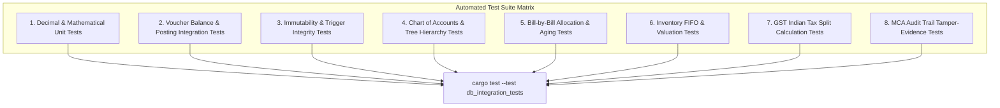

# Accounting Database Architecture: Initial Test Plan

**Application**: Independent Clean-Room Accounting Application  
**Target Platform**: Desktop (Tauri v2 + Rust + SQLite 3)  
**Test Framework**: Rust `cargo test`, `rusqlite`, in-memory SQLite fixtures (`:memory:`)  
**Version**: 1.0.0  
**Date**: October 22, 2026  

---

## 1. Test Strategy & Objectives

The test suite validates the core integrity invariants of the accounting system before any UI components are wired up:

1. **Mathematical Precision**: Proves zero floating-point drift across millions of transactions using 64-bit integer paise arithmetic.
2. **Double-Entry Equilibrium**: Proves that no unbalanced transaction can commit to the database.
3. **Immutability & Audit Integrity**: Proves that posted vouchers cannot be altered and audit trail records cannot be updated or purged.
4. **Relational & Constraint Integrity**: Proves unique voucher numbers per FY/type, foreign key enforcement, and valid hierarchical group trees.

---

## 2. Test Suite Matrix



---

## 3. Test Cases & Validation Scenarios

### 3.1 Category 1: Decimal Precision & Mathematical Safety

| Test ID | Test Scenario | Input Data | Expected Result |
| :--- | :--- | :--- | :--- |
| **TC-MATH-01** | Fractional cent/paise addition | $0.10 + 0.20$ as integer paise ($10 + 20$) | Sum is exactly $30$ paise (₹0.30), zero float drift. |
| **TC-MATH-02** | High-magnitude multi-crore balance | $₹500,000,000.00$ ($5 \times 10^{10}$ paise) | No 64-bit integer overflow; accurate summation across 10,000 transactions. |
| **TC-MATH-03** | Round-half-up tax calculation | Taxable ₹1,125.25 @ 18% GST = ₹202.545 | Rounded to ₹202.55 (20255 paise). Split: CGST 10128, SGST 10127 paise. |

### 3.2 Category 2: Double-Entry Balance & Voucher Posting

| Test ID | Test Scenario | Input Data | Expected Result |
| :--- | :--- | :--- | :--- |
| **TC-VCH-01** | Balanced 2-line voucher | Dr Cash ₹1,000 (100000 paise), Cr Sales ₹1,000 | Voucher status updates to `'Posted'` successfully. |
| **TC-VCH-02** | Unbalanced voucher posting attempt | Dr Bank ₹5,000, Cr Capital ₹4,900 | Trigger `trg_verify_voucher_balance_on_post` aborts with `ERR_VOUCHER_UNBALANCED`. |
| **TC-VCH-03** | Multi-line compound journal | Dr Rent ₹8,000, Dr Electricity ₹2,000, Cr Bank ₹10,000 | Balanced (10k Dr = 10k Cr); posts successfully. |
| **TC-VCH-04** | Duplicate voucher number prevention | Create two Sales vouchers with number `'S-001'` in same FY | Second insert aborts with UNIQUE constraint violation on `(company_id, fy_id, voucher_type_id, voucher_number)`. |

### 3.3 Category 3: Immutability & Anti-Silent Modification

| Test ID | Test Scenario | Input Data | Expected Result |
| :--- | :--- | :--- | :--- |
| **TC-IMM-01** | Direct update to posted voucher total | `UPDATE vouchers SET total_amount_paise = 200000 WHERE status = 'Posted'` | Trigger `trg_prevent_posted_voucher_update` aborts with `ERR_POSTED_VOUCHER_IMMUTABLE`. |
| **TC-IMM-02** | Altering date of posted voucher | `UPDATE vouchers SET voucher_date = '2026-06-01' WHERE status = 'Posted'` | Trigger aborts with `ERR_POSTED_VOUCHER_IMMUTABLE`. |
| **TC-IMM-03** | Inserting new line into posted voucher | `INSERT INTO voucher_entries ...` referencing a posted `voucher_id` | Trigger `trg_prevent_posted_line_insert` aborts with `ERR_POSTED_VOUCHER_IMMUTABLE`. |
| **TC-IMM-04** | Authorized cancellation flow | `UPDATE vouchers SET status = 'Cancelled'` | Allowed; voucher marked cancelled and audit log records prior state. |

### 3.4 Category 4: MCA Audit Trail Immutability

| Test ID | Test Scenario | Input Data | Expected Result |
| :--- | :--- | :--- | :--- |
| **TC-AUD-01** | Attempted deletion of audit trail record | `DELETE FROM audit_trail WHERE log_id = 1` | Trigger `trg_audit_trail_immutable_delete` aborts with `ERR_AUDIT_TAMPERING`. |
| **TC-AUD-02** | Attempted modification of audit log | `UPDATE audit_trail SET action = 'UPDATE'` | Trigger `trg_audit_trail_immutable_update` aborts with `ERR_AUDIT_TAMPERING`. |
| **TC-AUD-03** | Cryptographic hash chaining | Insert sequential log records | Each record's `prev_hash` equals prior record's `record_hash`; full chain verifies. |

### 3.5 Category 5: Inventory Valuation (FIFO & Weighted Average)

| Test ID | Test Scenario | Inward / Outward Movement | Expected Valuation Result |
| :--- | :--- | :--- | :--- |
| **TC-INV-01** | FIFO multi-lot consumption | Inward: 100 @ ₹50; Inward: 50 @ ₹60; Outward: 120 | COGS: $(100 \times 50) + (20 \times 60) = ₹6,200$. Closing stock: 30 @ ₹60 = ₹1,800. |
| **TC-INV-02** | Weighted average cost recalculation | Inward: 100 @ ₹10; Inward: 100 @ ₹20 | Moving average rate updates to ₹15.00. Outward of 50 units valued at $50 \times 15 = ₹750$. |
| **TC-INV-03** | Warehouse stock isolation | Item A in Godown 1 (50 units), Godown 2 (100 units) | Outward from Godown 1 of 60 units fails if negative stock disallowed in that godown. |

### 3.6 Category 6: Bill-by-Bill Allocations & Settlements

| Test ID | Test Scenario | Input Allocation | Expected Result |
| :--- | :--- | :--- | :--- |
| **TC-BILL-01** | Sales invoice with New Ref | Invoice `INV-101` for ₹25,000 allocated as `NewRef: INV-101` | Bill allocation records ₹25,000 Dr against ledger. |
| **TC-BILL-02** | Receipt settling Agst Ref | Receipt of ₹15,000 allocated as `AgstRef: INV-101` | Outstanding balance on `INV-101` drops from ₹25,000 to ₹10,000 Dr. |
| **TC-BILL-03** | Over-settlement alert | Attempt `AgstRef: INV-101` for ₹30,000 | System rejects settlement or splits excess ₹5,000 to `Advance` / `OnAccount`. |

---

## 4. Automated Rust Integration Test Implementation

```rust
// tests/db_integration_tests.rs
use rusqlite::{Connection, params};

fn setup_test_db() -> Connection {
    let conn = Connection::open_in_memory().expect("Failed to open in-memory SQLite DB");
    conn.execute_batch("PRAGMA foreign_keys = ON;").unwrap();
    
    // Load schema.sql
    let schema = include_str!("../schema.sql");
    conn.execute_batch(schema).expect("Failed to execute schema.sql");
    
    // Seed test company & financial year
    conn.execute(
        "INSERT INTO companies (company_id, company_number, name, mailing_name, state_code) 
         VALUES ('c-1', '10001', 'Acme Corp', 'Acme Corp', '27')",
        [],
    ).unwrap();
    conn.execute(
        "INSERT INTO financial_years (fy_id, company_id, fy_start_date, fy_end_date, books_beginning_date) 
         VALUES ('fy-1', 'c-1', '2026-04-01', '2027-03-31', '2026-04-01')",
        [],
    ).unwrap();
    
    conn
}

#[test]
fn test_double_entry_balance_trigger() {
    let conn = setup_test_db();
    
    // Setup voucher types & ledgers
    conn.execute("INSERT INTO account_groups VALUES ('g-1', 'c-1', 'Bank', NULL, 'Asset', 0, 1, 1, 'now')", []).unwrap();
    conn.execute("INSERT INTO ledgers VALUES ('l-1', 'c-1', 'g-1', 'Cash', 'C1', 0, NULL, 0, 0, NULL, NULL, NULL, NULL, NULL, NULL, 1, 'now', 'now')", []).unwrap();
    conn.execute("INSERT INTO ledgers VALUES ('l-2', 'c-1', 'g-1', 'Bank', 'B1', 0, NULL, 0, 0, NULL, NULL, NULL, NULL, NULL, NULL, 1, 'now', 'now')", []).unwrap();
    conn.execute("INSERT INTO voucher_types VALUES ('vt-1', 'c-1', 'Contra', 'Contra', 'Manual', '', '', 1, 1)", []).unwrap();
    
    // Insert Draft Voucher
    conn.execute(
        "INSERT INTO vouchers (voucher_id, company_id, fy_id, voucher_type_id, voucher_number, voucher_date, total_amount_paise, status) 
         VALUES ('v-1', 'c-1', 'fy-1', 'vt-1', '001', '2026-04-15', 500000, 'Draft')",
        [],
    ).unwrap();
    
    // Unbalanced entries (Dr 5000, Cr 4000)
    conn.execute("INSERT INTO voucher_entries VALUES ('e-1', 'v-1', 1, 'l-1', 'Dr', 500000, NULL)", []).unwrap();
    conn.execute("INSERT INTO voucher_entries VALUES ('e-2', 'v-1', 2, 'l-2', 'Cr', 400000, NULL)", []).unwrap();
    
    // Attempt to post -> Must Fail
    let res = conn.execute("UPDATE vouchers SET status = 'Posted' WHERE voucher_id = 'v-1'", []);
    assert!(res.is_err(), "Unbalanced voucher must not post!");
    
    // Balance entries -> Must Succeed
    conn.execute("UPDATE voucher_entries SET amount_paise = 500000 WHERE entry_id = 'e-2'", []).unwrap();
    let res_balanced = conn.execute("UPDATE vouchers SET status = 'Posted' WHERE voucher_id = 'v-1'", []);
    assert!(res_balanced.is_ok(), "Balanced voucher must post successfully!");
}

#[test]
fn test_audit_trail_tamper_resistance() {
    let conn = setup_test_db();
    
    conn.execute(
        "INSERT INTO audit_trail (company_id, entity_type, entity_id, action, record_hash) 
         VALUES ('c-1', 'vouchers', 'v-1', 'INSERT', 'hash-abc-123')",
        [],
    ).unwrap();
    
    // Attempt update -> Must Fail
    let update_res = conn.execute("UPDATE audit_trail SET action = 'UPDATE' WHERE log_id = 1", []);
    assert!(update_res.is_err(), "Audit trail update must be blocked by trigger!");
    
    // Attempt delete -> Must Fail
    let delete_res = conn.execute("DELETE FROM audit_trail WHERE log_id = 1", []);
    assert!(delete_res.is_err(), "Audit trail delete must be blocked by trigger!");
}
```

---

## 5. Continuous Testing & Quality Gates

Run the test suite during continuous integration:

```bash
# Run all unit and integration tests
cargo test --verbose

# Run with address sanitizer to verify memory safety
RUSTFLAGS="-Zsanitizer=address" cargo test --target x86_64-unknown-linux-gnu

# Run test coverage
cargo tarpaulin --out Html --output-dir target/coverage
```
